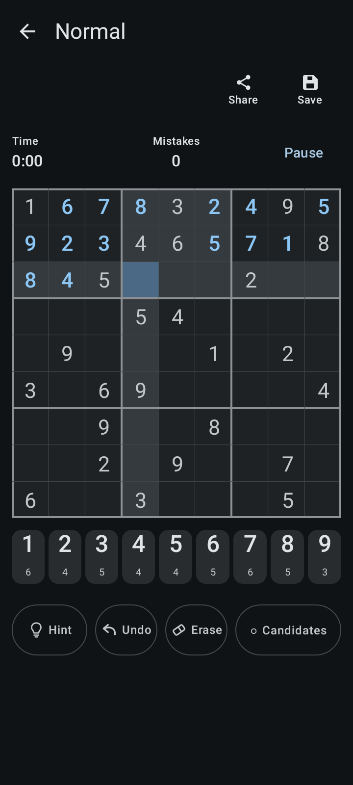

# Kratkoza

Kratkoza to natywna gra Sudoku na Androida, napisana w Kotlinie z użyciem Jetpack Compose. Oferuje
rozgrywkę solo, codzienne plansze z rankingami Google Play Games, pięć poziomów trudności, notatki
kandydatów, historię rozwiązanych plansz, statystyki oraz interfejs po polsku i angielsku.



## Najważniejsze funkcje

- generowanie plansz z unikalnym rozwiązaniem i klasyfikacją według technik logicznych,
- pięć poziomów trudności,
- Daily Sudoku i publiczne rankingi Google Play Games,
- kandydaci, automatyczne usuwanie nieaktualnych kandydatów, Undo i podpowiedzi,
- automatyczny zapis, wznawianie oraz udostępnianie plansz kodem,
- historia ukończonych plansz, statystyki i system XP,
- jasny i ciemny motyw, cztery palety oraz tryb wysokiego kontrastu,
- język polski i angielski.

## Stos technologiczny

- Kotlin i Java 17,
- Jetpack Compose i Material 3,
- Room oraz DataStore,
- Google Play Games Services v2,
- jeden moduł Android `:app`, ręczne dependency injection.

Minimalna obsługiwana wersja to Android 10 (`minSdk 29`). Projekt kompiluje się przeciwko API 37
i celuje w API 36.

## Budowanie

Standardowy build wymaga JDK 17 oraz Android SDK z platformą API 37. Po skonfigurowaniu
`ANDROID_HOME` lub `local.properties` można użyć Gradle Wrappera:

```bash
./gradlew :app:assembleDebug
./gradlew :app:testDebugUnitTest
./gradlew :app:lintDebug
```

Skrypty z `scripts/` automatyzują ten proces w warsztacie używanym do rozwijania projektu. Są na
razie zależne od jego układu `/mnt/workspace/.tooling`; ich opis znajduje się w
[`docs/BUILD.md`](docs/BUILD.md).

Build podpisany obcym certyfikatem nie zaloguje się do produkcyjnej konfiguracji Play Games, dopóki
jego para `applicationId` i SHA-1 nie zostanie dodana jako właściwy klient Android OAuth.

## Dokumentacja

- [`project.md`](project.md) — wymagania funkcjonalne,
- [`technical_requirements.md`](technical_requirements.md) — wymagania techniczne,
- [`docs/ARCHITECTURE.md`](docs/ARCHITECTURE.md) — architektura i decyzje projektowe,
- [`docs/STATUS.md`](docs/STATUS.md) — aktualny stan realizacji,
- [`docs/BUILD.md`](docs/BUILD.md) — budowanie, testowanie i podpisywanie,
- [`docs/OPEN_QUESTIONS.md`](docs/OPEN_QUESTIONS.md) — otwarte decyzje,
- [`docs/WISHLIST.md`](docs/WISHLIST.md) — pomysły na dalszy rozwój.

## Licencja

Licencja projektu nie została jeszcze wybrana. Do czasu dodania pliku `LICENSE` kod pozostaje
objęty pełnym prawem autorskim i samo publiczne udostępnienie repozytorium nie zezwala na jego
ponowne wykorzystanie ani rozpowszechnianie. Porównanie rozważanych wariantów znajduje się w
[`github.md`](github.md).
